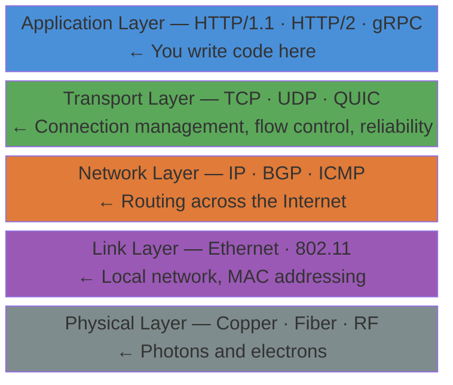
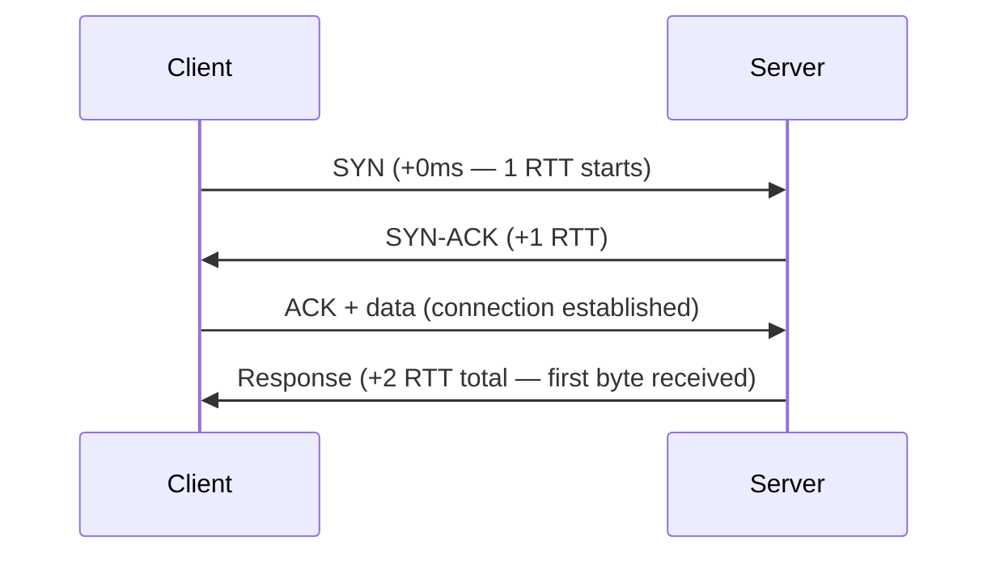
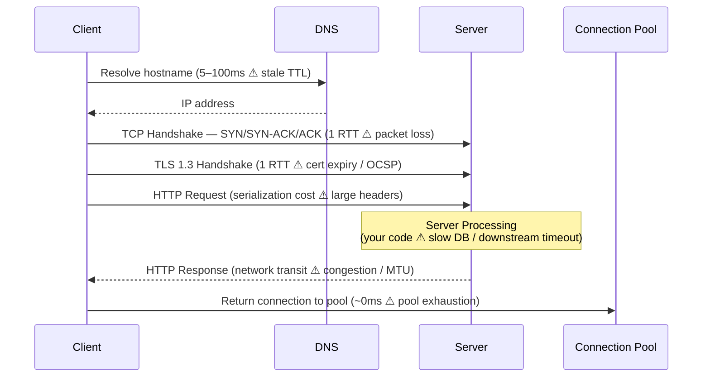
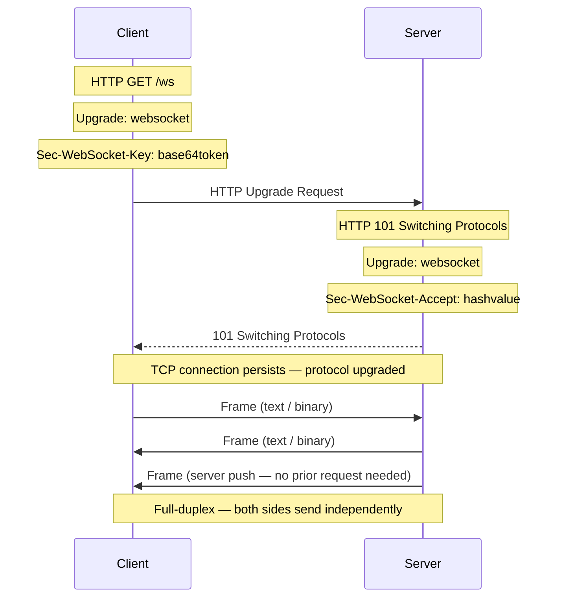

# Web Fundamentals — Principal Engineer's Reference

> "The network is the computer." — John Gage, Sun Microsystems  
> Understanding the network stack deeply is prerequisite to building systems that are resilient, observable, and performant at scale.

---

## The Network Stack — Why Every Layer Matters

The Internet Protocol suite is a layered abstraction. At production scale, **every layer has failure modes, latency costs, and tuning knobs** that directly affect your SLOs.



**Principal Engineer perspective**: Most application bugs that present as "random failures" are actually TCP-level issues — connection pool exhaustion, TIME_WAIT accumulation, or MTU mismatches manifesting at the application layer. You must be able to diagnose at every layer with `tcpdump`, `ss`, `netstat`, and `strace`.

---

## TCP — The Foundation You Cannot Ignore

HTTP runs over TCP. TCP provides **reliable, ordered, byte-stream delivery** — and this comes at a cost you need to reason about explicitly.

### The TCP Handshake and Latency Budget



**At P99 for a cross-region call (e.g., US-East → EU-West, ~80ms RTT):**
- TCP handshake alone = 160ms before TLS, before HTTP, before your application code runs.
- TLS 1.2 adds another 1–2 RTTs = up to 320ms additional overhead.
- **TLS 1.3** reduces this to 1-RTT (and 0-RTT resumption), saving ~80–160ms per cold connection. **Always use TLS 1.3.**

### Critical TCP Tuning at Scale

| Kernel Parameter | What It Controls | Production Default | Why It Matters |
|---|---|---|---|
| `tcp_tw_reuse` | TIME_WAIT socket reuse | 0 (off) | Enable on clients to avoid port exhaustion under high QPS |
| `somaxconn` | Listen backlog | 128 | Increase to 4096+ on high-traffic services to prevent SYN drops |
| `tcp_fin_timeout` | FIN_WAIT_2 timeout | 60s | Reduce to 15s to reclaim sockets faster |
| `tcp_nodelay` | Disables Nagle's algorithm | varies | **Always enable** for request/response APIs — Nagle adds up to 200ms latency |
| `net.core.somaxconn` | Kernel socket queue | 128 | Set to 65535 on load balancers |

**Nagle's Algorithm deep-dive**: Nagle coalesces small TCP segments to reduce packet count. For bulk data transfer this is good. For interactive APIs (HTTP, gRPC), it is catastrophic — it can delay your 40-byte HTTP response header by up to 200ms waiting to fill a segment. Always set `TCP_NODELAY` on service-to-service connections.

```bash
# Verify TCP_NODELAY is in effect (visible in curl verbose output)
curl -v 'https://api.retailer.com/health'
# * TCP_NODELAY set
```

### Connection Pooling — The Most Common Scalability Mistake

Every TCP connection you open pays the full RTT handshake cost. At 10,000 RPS, creating a new connection per request is a guaranteed latency cliff and CPU bottleneck.

```
Without pooling:  10,000 RPS × ~160ms handshake = latency disaster + CPU thrash
With pooling:     Connections are reused — amortized handshake cost approaches zero
```

**Production rules:**
- Always use **connection pools** for all downstream calls (HTTP, DB, Redis, gRPC).
- Pool size formula: `pool_size = (QPS × avg_latency_seconds) + headroom`
  - Example: 1000 RPS × 0.1s avg latency = 100 min connections. Add 20% → 120.
- Monitor pool saturation (`pool_wait_time`, `pool_exhausted_count`) as a leading indicator of outages.

---

## HTTP — The Protocol That Runs the Internet

### URL Anatomy

```
https://api.retailer.com:443/v2/users/123?fields=name,email&format=json#section
└──┬──┘  └──────┬──────┘└┬┘└────┬─────┘└────────────┬────────────────┘└───┬──┘
 scheme       host      port   path             query string            fragment
```

**URI vs URL vs URN:**

| Concept | Purpose | Example |
|---|---|---|
| **URI** (Uniform Resource Identifier) | Abstract identifier for any resource | superset of URL and URN |
| **URL** (Uniform Resource Locator) | Identifies + locates a resource | `https://api.retailer.com/v1/users/123` |
| **URN** (Uniform Resource Name) | Persistent name, location-independent | `urn:isbn:0-486-27557-4` |

In practice: every URL is a URI. Design resource paths to be **stable, version-tolerant, and meaningful** — a URL is a contract with your consumers.

### HTTP Evolution — The Why Behind Each Version

```
HTTP/1.0    New TCP connection per request/response. No keep-alive.
            Cost: full TCP + TLS handshake on every single request.

HTTP/1.1    Persistent connections (keep-alive). Pipelining (rarely implemented correctly).
            Head-of-line blocking: request N blocks until request N-1 completes on that connection.
            Still widely deployed. Tune connection pool sizes explicitly.

HTTP/2      Binary framing. Multiplexes streams over a single TCP connection.
            Eliminates HTTP-level HOL blocking.
            Header compression via HPACK. Server Push (largely deprecated in practice).
            Still has TCP-level HOL blocking — one lost packet stalls all streams.

HTTP/3      Runs over QUIC (UDP-based transport).
            Eliminates TCP-level HOL blocking — each QUIC stream is independent.
            0-RTT connection resumption. Built-in TLS 1.3.
            Ideal for mobile clients on unreliable networks.
```

**Principal Engineer recommendation**: Use **HTTP/2** for all internal service-to-service calls. Deploy **HTTP/3** at the edge (CDN, load balancer) for external traffic. Deprecate HTTP/1.1 for high-throughput internal services.

### HTTP Request Lifecycle — Full Stack Latency View



**Every step is a potential latency contributor and failure point.** Instrument each phase with distributed tracing spans (OpenTelemetry). P99 regressions are often DNS TTL expiry, TLS certificate chain validation delays, or connection pool exhaustion — not your application code.

---

## HTTP Status Codes — Use Them Correctly, Every Time

Correct status codes are the difference between an observable, debuggable system and a black box. Every monitoring tool, circuit breaker, and client error handler depends on them.

| Code | Meaning | Correct Usage |
|---|---|---|
| **200** OK | Success | GET, PUT, PATCH responses with body |
| **201** Created | Resource created | POST — always include `Location: /v1/resources/{id}` header |
| **202** Accepted | Async work queued | Long-running operations — return a job/task ID for polling |
| **204** No Content | Success, no body | DELETE, or mutations with no response body |
| **301** Moved Permanently | Permanent redirect | API migration — clients should update their stored URLs |
| **304** Not Modified | Cache valid | ETag/If-None-Match match — client uses cached copy, no body sent |
| **400** Bad Request | Client input error | Validation failure — return structured field-level error body |
| **401** Unauthorized | Authentication required | Missing/invalid credentials — do not return 403 to avoid info leak |
| **403** Forbidden | Authenticated, not authorized | Lacks permission for this resource/action |
| **404** Not Found | Resource absent | Do not return for authorization failures (information leakage) |
| **405** Method Not Allowed | Wrong HTTP verb | Include `Allow: GET, POST` header |
| **409** Conflict | State conflict | Idempotency violation, optimistic locking failure |
| **429** Too Many Requests | Rate limit hit | Include `Retry-After: <seconds>` header |
| **499** Client Disconnected | Client hung up (nginx) | High rate = client timeout < server P99 — fix timeout config |
| **500** Internal Server Error | Unhandled fault | **Never** expose stack traces — log internally, return opaque error ID |
| **502** Bad Gateway | Invalid upstream response | Load balancer can't reach service — check health checks |
| **503** Service Unavailable | Overloaded or down | Return `Retry-After`. Client circuit breaker should open |
| **504** Gateway Timeout | Upstream timed out | Tune timeouts; check for slow downstream dependencies |

**Never return `200 OK` with an error body.** This breaks every monitoring tool, circuit breaker, and client retry handler in your ecosystem.

**The 499 metric is critical at scale**: A high `499` rate means clients are timing out before your server finishes. Before investigating application code, verify that client-side timeout > server P99 processing time. This is one of the most common misconfiguration patterns.

---

## HTTP Caching — The Highest-Leverage Performance Optimization

Done correctly, caching reduces origin load by 80–95%. Done incorrectly, it serves stale data or prevents scaling.

### Cache Layers


Each layer needs an **explicit strategy**: what gets cached, for how long, and how it gets invalidated.

### ETag — Conditional Requests

```
# First request — server computes ETag (hash or version of response)
GET /api/v1/users/123
← 200 OK
← ETag: "a1b2c3d4e5f6"
← Cache-Control: max-age=60, must-revalidate

# Subsequent request — client sends ETag for validation
GET /api/v1/users/123
→ If-None-Match: "a1b2c3d4e5f6"

← 304 Not Modified   (zero body bytes transferred — saves bandwidth and CPU)
  OR
← 200 OK + ETag: "newHashValue"  (resource changed — full response)
```

**At scale**: ETags eliminate redundant data transfer for read-heavy workloads. A user profile API at 100,000 RPS returning 5KB responses with 90% ETag cache hit rate eliminates ~405GB/hour of bandwidth. This is free throughput.

### Cache-Control Directives

```
Cache-Control: no-store                      # Never cache — use for auth tokens, PII
Cache-Control: no-cache                      # Cache but always revalidate via ETag
Cache-Control: max-age=3600                  # Cache 1 hour, no revalidation
Cache-Control: s-maxage=300                  # CDN TTL (overrides max-age for shared caches)
Cache-Control: stale-while-revalidate=60     # Serve stale while refreshing in background (low latency)
Cache-Control: stale-if-error=86400          # Serve stale if origin is DOWN (resilience pattern)
```

**`stale-if-error` is a resilience pattern**: when your origin fails, CDN/edge continues serving cached responses. This is a last line of defense against customer-facing outages during deploys or incidents.

---

## WebSockets — When HTTP Request/Response Is Not Enough

HTTP is inherently client-initiated. For real-time use cases (live dashboards, collaborative editing, trading feeds, multiplayer gaming), polling is wasteful and slow.

### Comparison of Real-Time Patterns

| Pattern | Latency | Server Load | Direction | Use Case |
|---|---|---|---|---|
| **Short Polling** | High (N sec) | High (idle requests) | Client→Server | Avoid — wastes resources |
| **Long Polling** | Medium | Medium | Client→Server | Legacy fallback only |
| **Server-Sent Events** | Low | Low | Server→Client only | Live feeds, notifications |
| **WebSocket** | Very Low | Medium | Full-duplex | Chat, collaboration, real-time bidirectional |
| **gRPC Streaming** | Very Low | Low | Full-duplex | Service-to-service real-time (binary, typed) |

### WebSocket Connection Upgrade



**Scaling WebSocket servers is stateful** — clients are pinned to a specific server instance. This conflicts with stateless horizontal scaling. Production solutions:
1. **Redis Pub/Sub** as a fan-out bus — any server instance can message any connected client.
2. **Consistent hashing** at the load balancer to route a user's connections to the same pod.
3. **Managed services** (AWS API Gateway WebSocket, Azure Web PubSub) that abstract statefulness entirely.

---

## Same-Origin Policy and CORS — Security at the Browser Boundary

### Same-Origin Policy

A browser enforces that JavaScript from `https://app.retailer.com:443` **cannot read responses** from `https://api.retailer.com:443` — even the same domain on a different port is a different origin.

```
Origin = scheme + host + port

https://app.retailer.com:443   ≠   https://api.retailer.com:443   (different host)
https://app.retailer.com:443   ≠   http://app.retailer.com:80     (different scheme + port)
https://app.retailer.com:443   =   https://app.retailer.com:443   (same origin ✓)
```

This is a **critical CSRF and data exfiltration defense**. Do not circumvent it carelessly.

### CORS — Controlled Cross-Origin Access

```
# Browser sends preflight before actual request
OPTIONS /api/v1/orders
Origin: https://app.retailer.com
Access-Control-Request-Method: POST

# Server explicitly grants permission
HTTP/1.1 204 No Content
Access-Control-Allow-Origin: https://app.retailer.com   ← NEVER use * for authenticated APIs
Access-Control-Allow-Methods: GET, POST, PUT, DELETE
Access-Control-Allow-Headers: Authorization, Content-Type
Access-Control-Max-Age: 86400                          ← Cache preflight 24h to cut OPTIONS overhead
```

**Security rule**: **Never use `Access-Control-Allow-Origin: *` on authenticated endpoints.** Wildcard CORS on auth-protected APIs enables CSRF from any malicious website.

---

## Ports and Sockets — Connection Mechanics

```
Socket     = IP address + Port + Protocol (TCP/UDP) = unique network endpoint
Connection = 4-tuple: (source_ip, source_port, dest_ip, dest_port)
```

**Port exhaustion** is a common production failure at high throughput:
- Ephemeral ports on Linux: 32768–60999 = ~28,000 available outbound connections per IP.
- At 10,000 RPS with 3s average connection lifetime: 30,000 concurrent sockets needed — **you will exhaust ports without pooling**.
- Solutions: connection pooling, `tcp_tw_reuse`, multiple source IPs via SNAT at the load balancer.

```bash
# Diagnose connection state distribution in production
ss -s

# Find TIME_WAIT accumulation (port exhaustion risk)
ss -tan | awk '{print $1}' | sort | uniq -c | sort -rn

# Count active connections to a specific port
ss -tn dst :443 | wc -l

# Find which process owns a port
ss -tlnp | grep :8080
```

---

## Network-Layer Observability

At scale, network and HTTP anomalies are **leading indicators** of service degradation, often preceding application-level errors by minutes.

| Metric | Alert Threshold | What It Indicates |
|---|---|---|
| `http_request_duration_p99` | > SLO threshold | Latency regression |
| `http_error_rate_5xx` | > 0.1% | Service or upstream fault |
| `http_error_rate_4xx` | Sudden spike | Client bug, auth service down |
| `tcp_conn_pool_wait_time_p99` | > 10ms | Pool saturation → scale out |
| `dns_resolution_time_p99` | > 50ms | DNS infrastructure issue |
| `tls_handshake_duration_p99` | > 200ms | Cert issue, slow CA, OCSP |
| `499_rate` | > 1% | Client timeout < server P99 processing time |

---

## Further Reading

- [High Performance Browser Networking — Ilya Grigorik (O'Reilly, free online)](https://hpbn.co/)
- [HTTP/3 Explained — Daniel Stenberg](https://http3-explained.haxx.se/)
- [TCP/IP Illustrated Vol. 1 — W. Richard Stevens](https://www.oreilly.com/library/view/tcpip-illustrated-volume/9780132808200/)
- [IETF RFC 9114 — HTTP/3](https://www.rfc-editor.org/rfc/rfc9114)
- [Site Reliability Engineering — Google (free online)](https://sre.google/sre-book/table-of-contents/)

Next: [REST — Representational State Transfer](2-REprStateTransfer.md)
