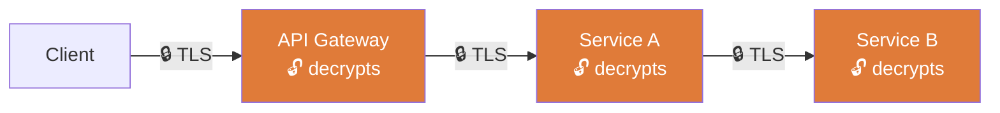

# REST — Representational State Transfer: Principal Engineer's Reference

> REST is not a protocol. It is an **architectural style** — a set of constraints that, when applied, produce a system with desirable properties: scalability, statelessness, cacheability, and uniform interfaces. Most APIs called "REST" are not RESTful. This matters at scale.

---

## What REST Actually Is — Beyond the Buzzword

REST was defined by Roy Fielding in his 2000 doctoral dissertation. The six constraints that define a REST architecture:

| Constraint | What It Means | Why It Matters at Scale |
|---|---|---|
| **Client-Server** | Separation of UI concerns from data storage | Independent scalability of frontend and backend |
| **Stateless** | Each request contains all information needed — no server-side session | Enables horizontal scaling; any instance can serve any request |
| **Cacheable** | Responses must declare whether they are cacheable | Reduces origin load by 80–95% with correct `Cache-Control` headers |
| **Uniform Interface** | Resources, representations, self-descriptive messages, HATEOAS | Decouples client from server implementation; enables API evolution |
| **Layered System** | Client cannot tell if it's talking to origin or intermediary | Enables CDN, API gateways, load balancers transparently |
| **Code on Demand** (optional) | Server can send executable code to client | Rarely used; enables extensibility |

**The stateless constraint is the most critical for scale.** The moment you store session state in a server-side HTTP session (Tomcat `HttpSession`, in-memory session store), you have broken REST and destroyed horizontal scalability. Every session becomes an affinity that ties a client to a specific instance.

**Correct approach**: State belongs in the client (JWT) or a distributed store (Redis, DynamoDB) — never in the application server process.

---

## Resource Design — The Heart of REST API Quality

A resource is a conceptual entity, not a database table. A representation is a snapshot of that resource's state at a point in time.

### Resource Naming — Rules Every Engineer Must Follow

```
# ✅ Correct — nouns, plural, lowercase, hyphenated
GET  /v1/users
GET  /v1/users/{userId}
GET  /v1/users/{userId}/orders
POST /v1/users/{userId}/orders
GET  /v1/payment-methods/{paymentMethodId}

# ❌ Wrong — verbs, mixed case, actions as paths
GET  /getUser
POST /createOrder
POST /users/UpdateProfile
GET  /user-Orders/{UserId}
```

**Why nouns?** HTTP methods ARE the verbs. `POST /users` already means "create a user". `POST /createUser` is redundant and breaks uniform interface.

### HTTP Methods — Semantics and Idempotency

| Method | Semantics | Idempotent | Safe (no side effects) | Use Case |
|---|---|---|---|---|
| **GET** | Read resource(s) | ✅ Yes | ✅ Yes | Fetch single resource or collection |
| **HEAD** | Read headers only | ✅ Yes | ✅ Yes | Check existence, ETag, Content-Length without downloading body |
| **POST** | Create or trigger action | ❌ No | ❌ No | Create resource, trigger async workflow |
| **PUT** | Replace entire resource | ✅ Yes | ❌ No | Full resource replacement (must send complete representation) |
| **PATCH** | Partial update | ❌ No* | ❌ No | Partial updates — use JSON Patch (RFC 6902) for well-defined semantics |
| **DELETE** | Remove resource | ✅ Yes | ❌ No | Delete — return 204 if deleted, 404 if not found |
| **OPTIONS** | Describe capabilities | ✅ Yes | ✅ Yes | CORS preflight; service capability discovery |

*PATCH can be made idempotent with conditional requests (`If-Match` + ETag).

**Idempotency is not optional at scale.** Networks fail. Clients retry. Load balancers retry on connection failure. If your `POST /orders` is not idempotent, you will create duplicate orders. The fix:
- Accept a client-provided **idempotency key** header (`Idempotency-Key: <uuid>`)
- Store the key and response; return the cached response for duplicate requests
- This is standard practice at Stripe, Square, Adyen, and every payment processor at scale

```
POST /v1/orders
Idempotency-Key: 550e8400-e29b-41d4-a716-446655440000
Content-Type: application/json

{"item": "SKU-123", "quantity": 2}
```

---

## API Versioning — Never Break Your Consumers

**API versioning is a contract commitment to your consumers.** Breaking changes without versioning cause cascading failures in production at 3am on a Friday.

### Versioning Strategies

| Strategy | Example | Trade-offs |
|---|---|---|
| **URL path versioning** | `/v1/users`, `/v2/users` | ✅ Explicit, cacheable, debuggable. ✅ Preferred |
| **Query parameter** | `/users?version=2` | ❌ Cache-unfriendly, easy to omit |
| **Header versioning** | `Accept: application/vnd.myapi.v2+json` | ❌ Not visible in URL, harder to debug and route |
| **Subdomain** | `v2.api.retailer.com` | ❌ DNS overhead, TLS cert complexity |

**Recommendation**: Use URL path versioning. It is explicit, cacheable, and trivially routable at the API gateway layer.

### Backward-Compatible Change Rules

```
✅ Safe changes (no version bump required):
   - Adding new optional request fields
   - Adding new response fields
   - Adding new endpoints
   - Adding new enum values (if client is lenient)

❌ Breaking changes (require new version):
   - Removing or renaming fields
   - Changing field types
   - Changing error response structure
   - Removing endpoints
   - Changing authentication scheme
```

---

## Request and Response Design

### Request Headers — Standard Fields

```
Authorization: Bearer <JWT>                  # Authentication
Content-Type: application/json               # Request body format
Accept: application/json                     # Desired response format
Idempotency-Key: <uuid>                      # Deduplication (mutations only)
X-Request-ID: <uuid>                         # Distributed tracing correlation ID
X-Forwarded-For: <client-ip>                 # Original client IP (set by proxy)
User-Agent: MyApp/2.1.0 (iOS 17.0)          # Client identification
If-None-Match: "etag-value"                  # Conditional GET (cache validation)
If-Match: "etag-value"                       # Conditional mutation (optimistic locking)
```

### Response Structure — Consistency Is a Contract

**Always return consistent, structured responses.** Inconsistent response shapes are the #1 cause of client-side bugs and API integration failures.

```json
// ✅ Success response
{
  "data": {
    "id": "usr_123",
    "email": "user@retailer.com",
    "createdAt": "2026-04-26T12:00:00Z"
  },
  "meta": {
    "requestId": "req_abc123",
    "timestamp": "2026-04-26T12:00:01Z"
  }
}

// ✅ Error response — structured, actionable, never leaks internals
{
  "error": {
    "code": "VALIDATION_FAILED",
    "message": "Request validation failed",
    "details": [
      {"field": "email", "issue": "Invalid email format"},
      {"field": "age",   "issue": "Must be 18 or older"}
    ],
    "requestId": "req_abc123",
    "docsUrl": "https://api.retailer.com/docs/errors#VALIDATION_FAILED"
  }
}
```

**Never expose**: stack traces, internal class names, SQL queries, file paths, or internal service names in error responses. Log them internally with the `requestId` for correlation.

### Pagination — Cursor-Based Is the Only Choice at Scale

**Offset-based pagination breaks at scale.** `LIMIT 20 OFFSET 10000` forces the database to scan 10,020 rows and discard 10,000. At page 500 with high concurrency, this becomes a full-table scan on every paginated request.

```
❌ Offset pagination (avoid for large datasets)
GET /v1/orders?page=500&pageSize=20
← scans 10,020 rows, unstable under concurrent inserts

✅ Cursor-based pagination (use this)
GET /v1/orders?limit=20&after=cursor_enc_ord_9876
← scans exactly 21 rows, stable under concurrent inserts
← returns: {"data": [...], "nextCursor": "cursor_enc_ord_9856", "hasMore": true}
```

Cursor values should be **opaque to the client** (base64-encoded, encrypted) to allow server-side implementation changes without breaking clients.

---

## Security — Authentication and Authorization

### HTTP is Stateless — State the Problem, Then Solve It Correctly

HTTP has no built-in notion of "logged in user." Every request is independent. **This is a feature, not a bug** — it enables horizontal scaling. Authentication must be explicit on every request.

### Auth Patterns — Comparison

| Pattern | Mechanism | Stateless? | Use Case |
|---|---|---|---|
| **Basic Auth over TLS** | `Authorization: Basic base64(user:pass)` | ✅ Yes | Internal services, scripts — never for user-facing APIs |
| **API Key** | `Authorization: ApiKey <key>` or custom header | ✅ Yes | Service-to-service, developer APIs |
| **JWT (Bearer Token)** | `Authorization: Bearer <jwt>` | ✅ Yes | User-facing APIs — self-contained claims |
| **OAuth 2.0** | Authorization Code / Client Credentials flow | ✅ Yes | Delegated access, third-party integrations |
| **mTLS** | Client certificate in TLS handshake | ✅ Yes | Service-to-service in zero-trust networks |
| **Session Cookie** | `Set-Cookie: JSESSIONID=...` | ❌ No | Legacy web apps — breaks horizontal scaling without sticky sessions |

**JWT at scale — what engineers miss:**
- JWTs are **not encrypted by default** — they are base64-encoded and signed. Never put PII in JWT claims unless using JWE (JSON Web Encryption).
- JWTs **cannot be invalidated** before expiry without a blocklist (which reintroduces state). Keep JWT TTLs short (15 minutes for access tokens) and use refresh tokens.
- Validate **every claim**: `iss`, `aud`, `exp`, `nbf`. A JWT from your own issuer with `aud: other-service` must be rejected by your service.

### TLS — Transport Security

TLS encrypts communication in transit between two endpoints only. It provides no protection once the data is received and decrypted.


For end-to-end protection across multiple service hops, use **application-layer encryption** (envelope encryption with a KMS) — not TLS alone.

**TLS configuration checklist:**
- TLS 1.3 minimum (disable 1.0, 1.1, and 1.2 where possible)
- Strong cipher suites only: `ECDHE-RSA-AES256-GCM-SHA384`, `CHACHA20-POLY1305`
- HSTS header: `Strict-Transport-Security: max-age=31536000; includeSubDomains; preload`
- Certificate rotation automated (90-day certs with auto-renewal via ACME/Let's Encrypt)

### Cryptographic Primitives

| Primitive | Type | Use Case |
|---|---|---|
| **RSA-2048+** | Asymmetric | Key exchange, digital signatures, certificate signing |
| **AES-256-GCM** | Symmetric | Bulk data encryption (authenticated encryption) |
| **SHA-256 / SHA-3** | Hash | Data integrity, password hashing (use bcrypt/argon2 for passwords, not SHA) |
| **HMAC-SHA256** | MAC | Request signing, webhook payload validation |
| **ECDSA / Ed25519** | Asymmetric signature | JWT signing (prefer over RSA for performance) |

**HMAC for API request signing:**
```java
// Server-side validation of signed webhook/API request
Mac mac = Mac.getInstance("HmacSHA256");
mac.init(new SecretKeySpec(apiSecret.getBytes(), "HmacSHA256"));
byte[] signature = mac.doFinal(requestBody.getBytes());
String expected = Base64.getEncoder().encodeToString(signature);
// Compare with constant-time comparison to prevent timing attacks
MessageDigest.isEqual(expected.getBytes(), receivedSignature.getBytes());
```

---

## Rate Limiting and Backpressure

Every public-facing API must implement rate limiting. Without it, a single misbehaving client can cause a denial-of-service for all other clients.

```
# Response when rate limit is exceeded
HTTP/1.1 429 Too Many Requests
Retry-After: 30
X-RateLimit-Limit: 1000
X-RateLimit-Remaining: 0
X-RateLimit-Reset: 1714132800

{"error": {"code": "RATE_LIMIT_EXCEEDED", "message": "Rate limit of 1000 req/min exceeded. Retry after 30s."}}
```

**Rate limiting strategies:**

| Algorithm | Behavior | Trade-offs |
|---|---|---|
| **Fixed Window** | N requests per window | Simple; burst allowed at window boundary |
| **Sliding Window** | N requests in last N seconds | Accurate; more complex state |
| **Token Bucket** | Tokens refill at rate R, burst up to capacity C | Allows controlled bursting; widely used |
| **Leaky Bucket** | Requests processed at fixed rate, excess queued/dropped | Smooth output; poor for bursty legitimate traffic |

**At scale**: Rate limiting state must live in a distributed store (Redis with Lua scripts for atomicity) — not in-process memory. In-process rate limiting is useless behind a load balancer with 10 instances.

---

## REST vs Alternatives — Choose the Right Tool

| Protocol | Best For | Not For |
|---|---|---|
| **REST/HTTP** | Public APIs, CRUD resources, browser clients | Real-time, streaming, binary efficiency |
| **gRPC** | Internal service-to-service, high throughput, typed contracts | Browser clients (limited support), simple CRUD |
| **GraphQL** | Client-driven queries, reducing over/under-fetching | Services where query complexity control is critical |
| **WebSocket** | Real-time bidirectional communication | Simple request/response |
| **SOAP** | Enterprise integrations with WS-Security, ACID transactions | New systems — complexity not justified |

**gRPC advantages over REST for internal services:**
- **Binary (Protocol Buffers)**: ~5–10x smaller payload than JSON, faster serialization
- **Strongly typed contracts**: compile-time API contract enforcement, no runtime schema drift
- **Bidirectional streaming**: native support without WebSocket upgrade complexity
- **HTTP/2 multiplexing**: multiple concurrent RPCs on a single connection

---

## Content Negotiation and Media Types

```
# Client requests specific format
GET /v1/reports/monthly
Accept: application/json          # Prefer JSON
Accept: text/csv                  # Or CSV
Accept: application/octet-stream  # Or binary

# Server responds with what it can provide
Content-Type: application/json; charset=utf-8

# Server cannot provide requested format
HTTP/1.1 406 Not Acceptable
```

**Common media types in production APIs:**

| Media Type | Use Case |
|---|---|
| `application/json` | Standard REST API payloads |
| `application/json+problem` (RFC 7807) | Structured error responses — standardized |
| `application/vnd.api+json` | JSON:API spec — standardized pagination, relationships |
| `application/x-protobuf` | gRPC / binary Protocol Buffers |
| `multipart/form-data` | File uploads |
| `application/x-ndjson` | Streaming newline-delimited JSON (log ingestion, bulk APIs) |

---

## HATEOAS — Hypermedia as the Engine of Application State

The most commonly omitted REST constraint. HATEOAS means responses include links to valid next actions, so clients do not need to hardcode URL structures.

```json
{
  "data": {
    "id": "order_123",
    "status": "pending",
    "total": 49.99
  },
  "links": {
    "self":    {"href": "/v1/orders/order_123",        "method": "GET"},
    "confirm": {"href": "/v1/orders/order_123/confirm","method": "POST"},
    "cancel":  {"href": "/v1/orders/order_123/cancel", "method": "DELETE"},
    "payment": {"href": "/v1/orders/order_123/payment","method": "POST"}
  }
}
```

**Practical benefit at scale**: HATEOAS decouples client navigation logic from server URL structure, enabling server-side URL changes and workflow changes without client redeployment. GitHub's API is a well-known example.

---

## REST vs SOAP — When Each Makes Sense

| Dimension | REST | SOAP |
|---|---|---|
| **Transport** | HTTP/HTTPS (primarily) | HTTP, SMTP, TCP, any transport |
| **Message Format** | JSON, XML, any | XML only (SOAP envelope) |
| **Security** | TLS (transport-level) | WS-Security (message-level, end-to-end across hops) |
| **Transactions** | No native support (use Saga pattern) | WS-AtomicTransaction (distributed ACID) |
| **Contract** | OpenAPI (optional) | WSDL (mandatory, machine-readable) |
| **Performance** | Lower overhead | Higher overhead (XML verbosity) |
| **Enterprise Integration** | Growing adoption | Entrenched in financial/telecom systems |

**REST's transport-level security limitation**: TLS encrypts data between two endpoints. In the chain below, each hop decrypts and re-encrypts — a compromised intermediate node can read plaintext:



SOAP's WS-Security encrypts the message payload end-to-end — the message is the security boundary, not the transport. A compromised intermediate node can read the plaintext. For high-security multi-hop financial workflows (SWIFT, healthcare HL7), WS-Security remains relevant.

---

## API Design Review Checklist

- [ ] Are all resources named with nouns (not verbs)?
- [ ] Is every mutating endpoint idempotent (or protected with an Idempotency-Key)?
- [ ] Is the API versioned (`/v1/`) with a documented deprecation policy?
- [ ] Are all list endpoints paginated with cursor-based pagination?
- [ ] Do all responses follow a consistent envelope structure?
- [ ] Are error responses structured with field-level detail — no stack traces?
- [ ] Are rate limiting headers returned on every response?
- [ ] Is authentication stateless (JWT/API key) — no server-side session?
- [ ] Are `Cache-Control` headers set correctly on every endpoint?
- [ ] Is there an OpenAPI/Swagger spec committed to the repository?
- [ ] Are breaking changes gated behind a new API version?
- [ ] Is TLS 1.3 enforced with HSTS?

---

## Further Reading

- [Roy Fielding's Dissertation — Architectural Styles and REST (2000)](https://www.ics.uci.edu/~fielding/pubs/dissertation/rest_arch_style.htm)
- [RFC 7807 — Problem Details for HTTP APIs](https://www.rfc-editor.org/rfc/rfc7807)
- [RFC 6902 — JSON Patch](https://www.rfc-editor.org/rfc/rfc6902)
- [The Pragmatic API — API design at Stripe](https://stripe.com/docs/api)
- [gRPC vs REST — When to use each](https://grpc.io/docs/what-is-grpc/faq/)
- [OAuth 2.0 — RFC 6749](https://www.rfc-editor.org/rfc/rfc6749)
- [JSON Web Token — RFC 7519](https://www.rfc-editor.org/rfc/rfc7519)

Next: [SOAP — Simple Object Access Protocol](3-SimpleObjectAccessProtocol.md)
